# Electrical Service Design of the LASSET Laboratory (Room 12B-16L)

**Three layouts, BNBC 2020 load calculations, and an independent protection audit**

[](https://github.com/intisar-int/lab-electrical-layout-bnbc/actions/workflows/ci.yml)


**BRAC University · Department of Electrical and Electronic Engineering**

<p align="center">
  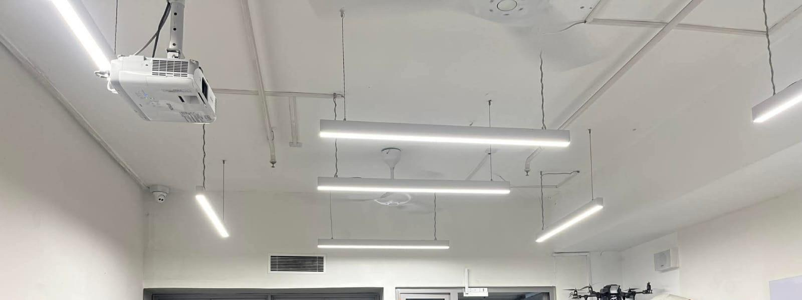
  <br/><em>Fig. 1 – Surveyed room 12B-16L: projector mount, suspended LED luminaires and ceiling fan (people cropped out).</em>
</p>

## Abstract

This project designs the electrical service for the LASSET laboratory (Room 12B-16L,
Building 12B, BRAC University, Dhaka) – a working robotics, embedded-systems and
electronics lab of about 38.6 m². After a site survey and photographic record, three
complete AutoCAD layouts were produced: a **six-circuit Base Design**, a **three-circuit
"BNBC-grouped" Design Approach 1** (lighting / general power / heavy load), and a
**six-circuit reorganised Design Approach 2**. Each was sized per BNBC 2020 with a 20 %
expansion margin (I = P / (V·PF), I<sub>design</sub> = 1.2·I<sub>calc</sub>), with cables and
MCBs selected against IEC 60228 and drawn as single-line, lighting, fan, socket and
heavy-load connection diagrams. **Design Approach 1** was recommended: it maps one-to-one
onto the BNBC load categories, offers the most sockets (8), has the simplest wiring and
isolates the AC and projector on a dedicated circuit (total connected load 4,663 W,
design current 27.23 A, 32 A main MCB, 4 mm² Cu main cable).

This repository packages the drawings, the report figures and the design data, and adds
(i) a **calculation engine** that re-derives every number in the report (34 automated
tests), (ii) an **independent protection-coordination audit** that finds the main-feeder
MCB rating exceeds the cable ampacity assigned in the report for all three designs,
(iii) a like-for-like maximum-demand comparison, (iv) a cable-run / voltage-drop envelope,
and (v) a lumen-method sensitivity check of the lighting claim.

**Keywords:** electrical service design · BNBC 2020 · load calculation · demand factor ·
MCB and cable coordination · single-line diagram · laboratory electrical layout · AutoCAD

---

## Contents

1. [Introduction and objectives](#1-introduction-and-objectives)
2. [Site and design basis](#2-site-and-design-basis)
3. [Method](#3-method)
4. [The three designs](#4-the-three-designs)
5. [Comparison and selection](#5-comparison-and-selection)
6. [Contribution: independent audit](#6-contribution-independent-audit)
7. [Limitations](#7-limitations)
8. [Reproducing the results](#8-reproducing-the-results)
9. [Repository layout](#9-repository-layout)
10. [Authors, references, licence](#10-authors-references-licence)

---

## 1. Introduction and objectives

LASSET is in continuous use by faculty and students, with soldering stations,
oscilloscopes, bench supplies, laptops, drones and test rigs running side by side. The
electrical service must therefore be safe, code-compliant, easy to extend and cheap to
install. The objectives were to:

- survey the room and produce an AutoCAD floor plan with key dimensions;
- design a BNBC 2020-compliant layout for lighting, ceiling fans and power outlets;
- produce cable routing and switch/circuit-board connection diagrams for each design;
- propose a base design and two alternatives and compare them on load, cost, complexity
  and compliance;
- perform load calculations with demand factors and select cables and MCBs per IEC 60228;
- justify the selected design quantitatively and qualitatively.

## 2. Site and design basis

<p align="center">
  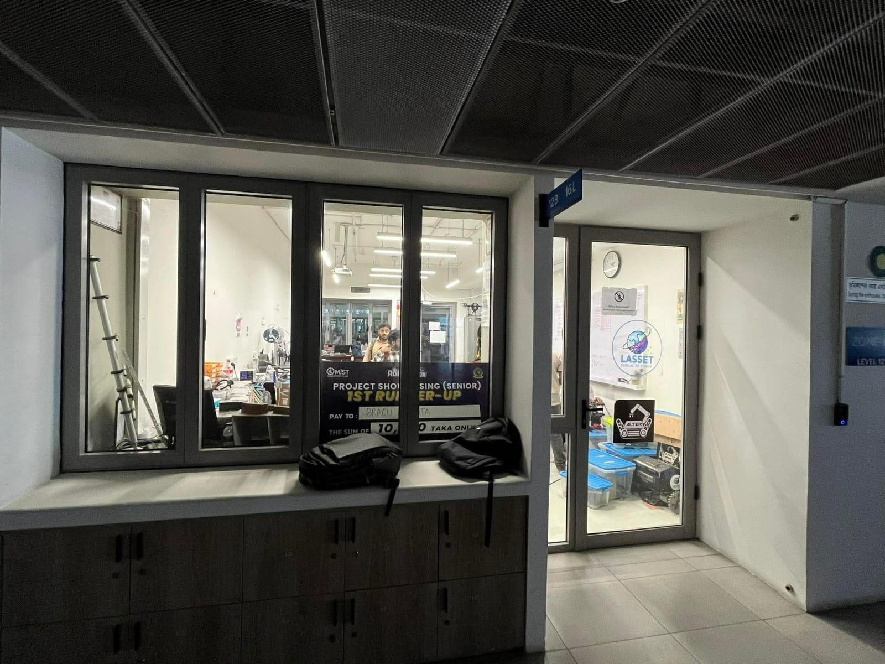
  <br/><em>Fig. 2 – Corridor view of the room entrance (Room 12B-16L, LASSET Lab).</em>
</p>

| Item | Value |
|------|-------|
| Room | 26 ft 10 in × 15 ft 6 in (≈ 8.18 m × 4.72 m), ≈ 38.6 m², plus a 2 ft 8 in lobby strip |
| Supply | 230 V, 50 Hz, single phase; meter → main MCB → sub-distribution board (SDB) |
| Power factors | lighting 1.0 · fans 0.90 · air conditioner 0.85 |
| Design margin | I<sub>design</sub> = 1.20 · I<sub>calc</sub> (BNBC 2020, as cited in the report) |
| Selection rules | MCB rating ≥ design current; cable per IEC 60228; lighting and heavy loads on separate circuits |
| Surveyed loads | 12 × 24 W LED tubes · 3 × 75 W ceiling fans · 8 × 300 W socket allowance (Approach 1) · AC 1,500 W · projector 250 W |

Non-technical constraints (cost, conduit-concealed wiring, regulatory compliance,
continuous occupancy, LED instead of fluorescent for energy saving) are discussed in the
report.

## 3. Method

For each circuit the report applies

```
I_calc   = P / (V · PF)         V = 230 V
I_design = 1.20 · I_calc
```

and picks the smallest standard cable and MCB with ampacity and rating above the design
current. Maximum demand applies BNBC demand factors (lighting 1.0, general power 0.8,
heavy load 1.0) to the connected load. The engine in
[`calc/service_calc.py`](calc/service_calc.py) implements exactly this from the circuit
schedule in [`data/designs.json`](data/designs.json) and is tested against the numbers
printed in the report.

## 4. The three designs

### 4.1 Base Design – six circuits (≈ 3,508 W, 40 A main)

| Ckt | Load | Connected | Cable | MCB | I<sub>design</sub> |
|-----|------|----------:|-------|----:|-------------------:|
| Ck-1 | 3 ceiling fans | 225 W | 1.5 mm² | 6 A | 1.30 A |
| Ck-2 | bottom LED row (6 tubes) | 144 W | 1.5 mm² | 6 A | 0.75 A |
| Ck-3 | top LED row (6 tubes) | 144 W | 1.5 mm² | 6 A | 0.75 A |
| Ck-4 | entry / lobby lighting | 45 W | 1.5 mm² | 6 A | 0.23 A |
| Ck-5 | 4 × 3-pin sockets | 1,200 W | 2.5 mm² | 10 A | 6.26 A |
| Ck-6 | AC + projector | 1,750 W | 2.5 mm² | 16 A | 10.51 A |
| **Main** | | **3,508 W** | **4 mm²** | **40 A** | **19.81 A** |

<table>
<tr>
<td align="center" valign="top">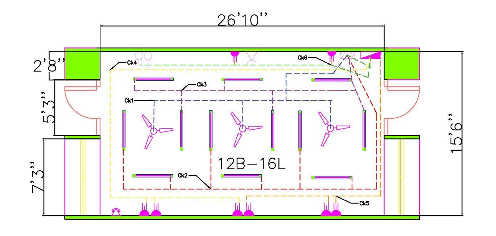<br/><sub>AutoCAD layout (source: <code>cad/Base_Design.dwg</code>)</sub></td>
<td align="center" valign="top">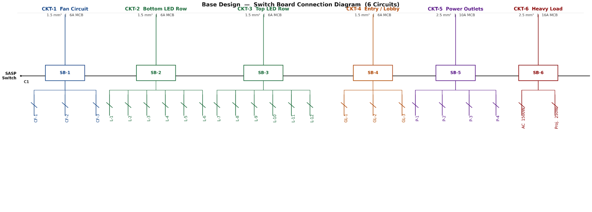<br/><sub>Switch-board connection diagram, six circuits</sub></td>
</tr>
</table>

### 4.2 Design Approach 1 – three circuits, BNBC-grouped (4,663 W, 32 A main) – **recommended**

| Ckt | Load | Connected | PF | I<sub>calc</sub> | I<sub>design</sub> | Cable | MCB |
|-----|------|----------:|---:|-----:|------:|-------|----:|
| CKT-1 | 12 LED tubes (lighting) | 288 W | 1.0 | 1.25 A | 1.50 A | 1.5 mm² | 6 A |
| CKT-2 | 3 fans + 8 sockets (general power) | 2,625 W | 0.9 | 12.68 A | 15.22 A | 2.5 mm² | 16 A |
| CKT-3 | AC + projector (heavy load) | 1,750 W | 0.85 / 1.0 | 8.76 A | 10.51 A | 2.5 mm² | 16 A |
| **Main** | | **4,663 W** | | **22.69 A** | **27.23 A** | **4 mm²** | **32 A** |

Maximum demand: 288 W × 1.0 + 2,625 W × 0.8 + 1,750 W × 1.0 = **4,138 W ≈ 18.0 A**.

<table>
<tr>
<td align="center" valign="top">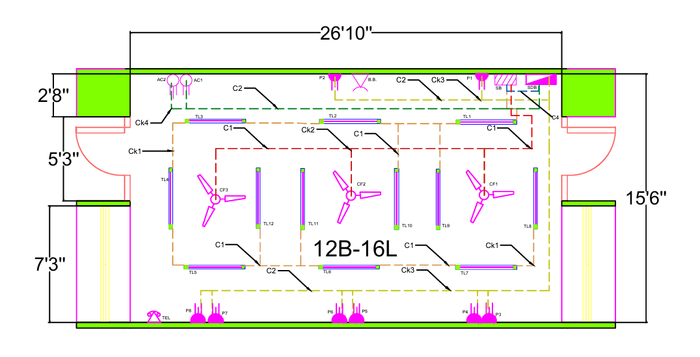<br/><sub>AutoCAD layout (<code>cad/Design_1.dwg</code>)</sub></td>
<td align="center" valign="top">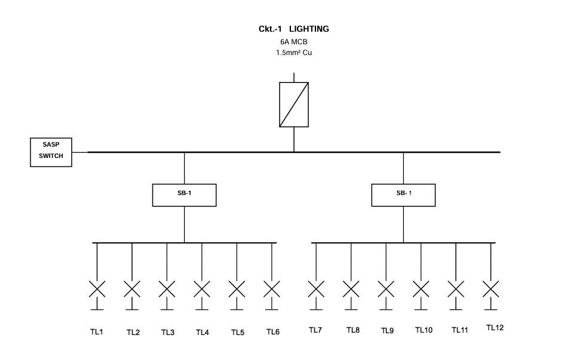<br/><sub>Lighting connection (12 tubes, two sub-boards)</sub></td>
</tr>
<tr>
<td align="center" valign="top">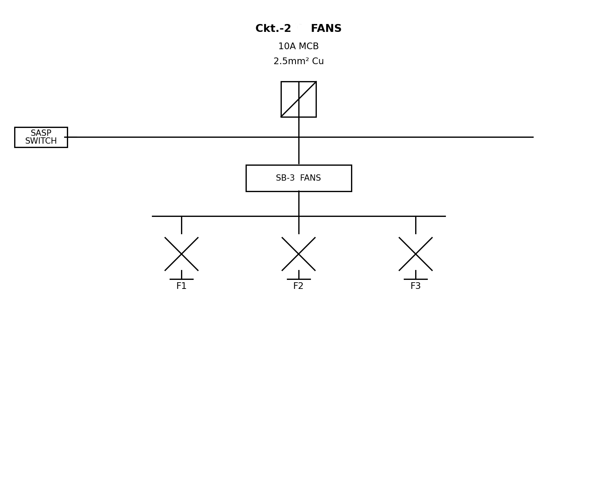<br/><sub>Fan connection</sub></td>
<td align="center" valign="top">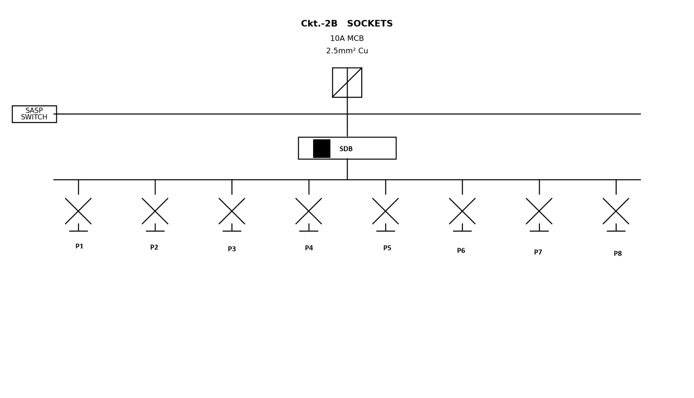<br/><sub>Eight 3-pin sockets</sub></td>
</tr>
<tr>
<td align="center" valign="top">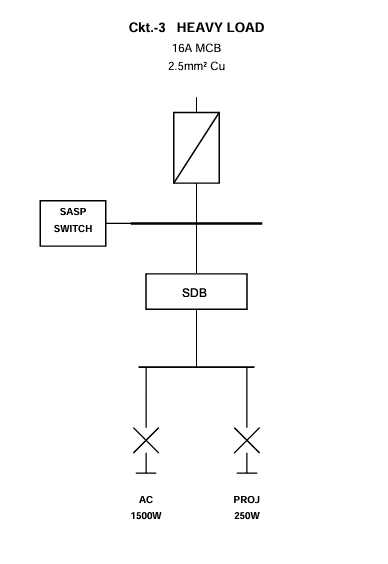<br/><sub>Heavy load (AC 1,500 W + projector 250 W)</sub></td>
<td></td>
</tr>
</table>

### 4.3 Design Approach 2 – six circuits, reorganised (4,036 W, 32 A main)

*Schedule as printed in the report; see finding [F6](#f6--approach-2-socket-arrangement-is-inconsistent-across-the-submission) for a discrepancy with its own socket diagram.*

| Ckt | Load | Connected | Cable | MCB | I<sub>design</sub> |
|-----|------|----------:|-------|----:|-------------------:|
| CKT-1 | top LED row (4 tubes) | 96 W | 1.5 mm² | 6 A | 0.50 A |
| CKT-2 | mid LED row (6 tubes) | 144 W | 1.5 mm² | 6 A | 0.75 A |
| CKT-3 | 2 ceiling fans | 150 W | 1.5 mm² | 6 A | 0.87 A |
| CKT-4 | bottom LED row (4 tubes) | 96 W | 1.5 mm² | 6 A | 0.50 A |
| CKT-5 | 6 × 3-pin sockets | 1,800 W | 2.5 mm² | 16 A | 9.39 A |
| CKT-6 | AC + projector | 1,750 W | 2.5 mm² | 16 A | 10.51 A |
| **Main** | | **4,036 W** | **4 mm²** | **32 A** | **22.52 A** |

<table>
<tr>
<td align="center" valign="top">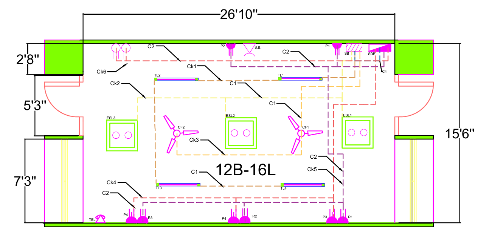<br/><sub>AutoCAD layout (<code>cad/Design_2.dwg</code>)</sub></td>
<td align="center" valign="top">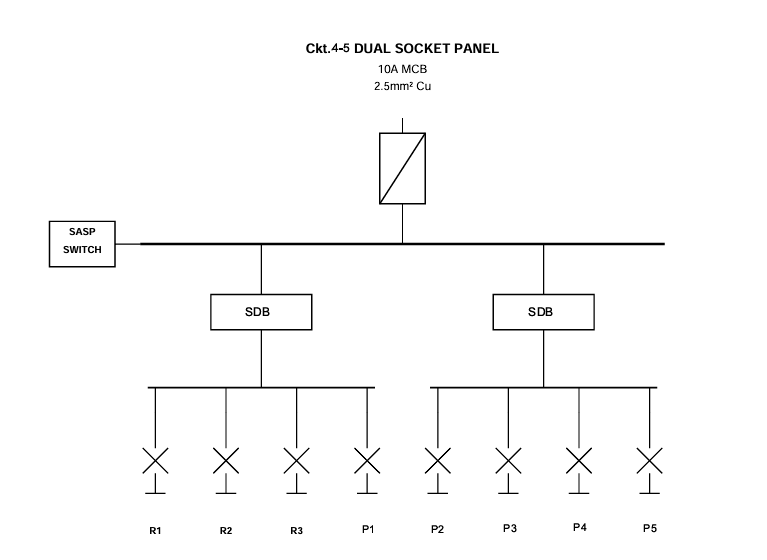<br/><sub>Dual socket panel</sub></td>
</tr>
<tr>
<td align="center" valign="top">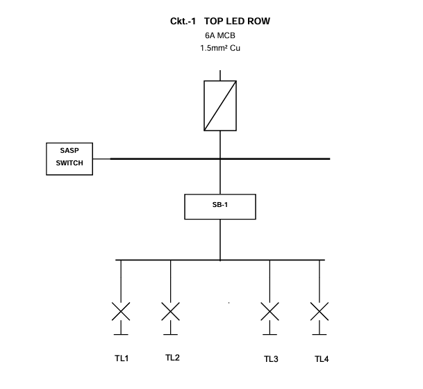<br/><sub>Top LED row</sub></td>
<td align="center" valign="top">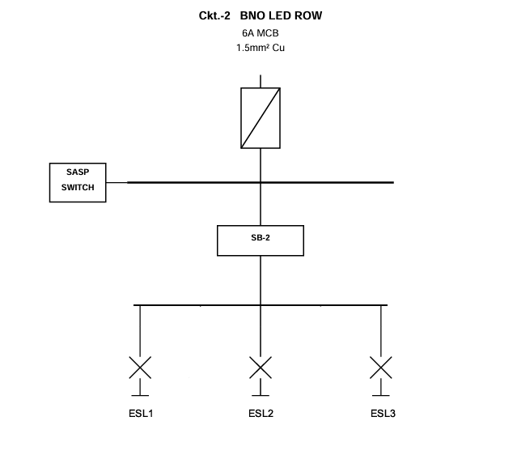<br/><sub>Energy-saving lighting row</sub></td>
</tr>
<tr>
<td align="center" valign="top">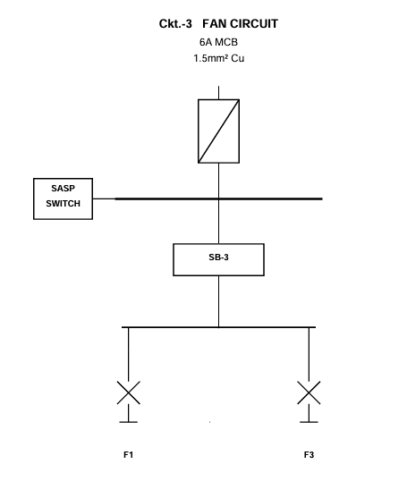<br/><sub>Fan circuit</sub></td>
<td align="center" valign="top">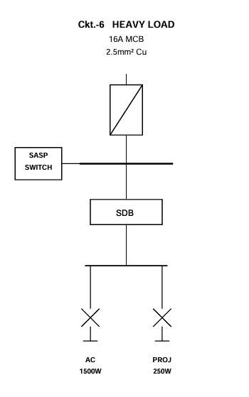<br/><sub>Heavy load</sub></td>
</tr>
</table>

## 5. Comparison and selection

| Parameter | Base | **Approach 1** | Approach 2 |
|-----------|------|----------------|------------|
| Circuits | 6 | **3** | 6 |
| Connected load | ≈ 3,508 W | 4,663 W | ≈ 4,036 W |
| 3-pin sockets | 4 | **8** | 6 |
| Heavy-load isolation | shared circuit | dedicated CKT-3 | dedicated CKT-6 |
| Main MCB | 40 A | 32 A | 32 A |
| BNBC category compliance | partial | **full** | partial |
| Wiring complexity / installation cost | high / higher | **low / lower** | high / higher |

The report's justification for Approach 1: (1) circuits map directly to the BNBC load
categories; (2) all currents are computed from first principles with the 20 % margin;
(3) the highest outlet density, which a lab with many simultaneous benches needs;
(4) three runs from the SDB instead of six; (5) a fault on the AC or projector does not
take down lighting or sockets; (6) twelve tubes spread over the whole room for
≥ 300 lux (200–300 lux required for workshop/laboratory occupancy).

## 6. Contribution: independent audit

Everything in this section was computed from the report's own inputs by
[`analysis/run_analysis.py`](analysis/run_analysis.py); results are stored in
[`analysis/results.json`](analysis/results.json). The calculation engine reproduces all
15 circuit rows and 3 design totals of the report (largest deviation 0.02 A, from rounding in the report);
the findings below are therefore about the design, not about arithmetic.

### F1 – Main-feeder MCB exceeds the cable ampacity assigned in the report (all designs)

Protection against overload requires **I<sub>b</sub> ≤ I<sub>n</sub> ≤ I<sub>z</sub>**
(design current ≤ MCB rating ≤ cable ampacity). All branch circuits satisfy it. The main
feeder does not: the report rates the 4 mm² Cu cable at **30 A** but protects it with a
**32 A** (Approaches 1 and 2) or **40 A** (Base) MCB.

<p align="center">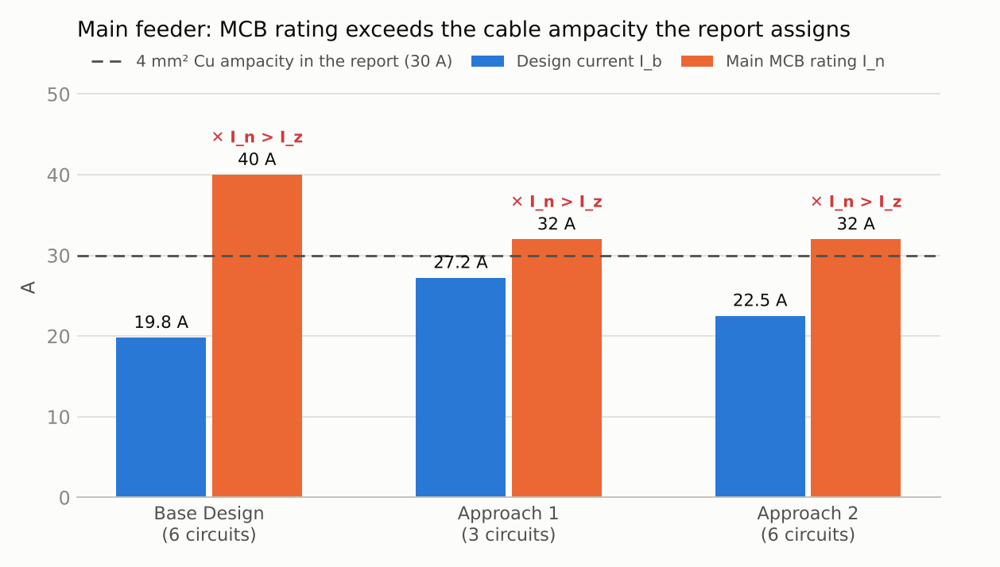</p>

| Design | I<sub>b</sub> | I<sub>n</sub> | I<sub>z</sub> (4 mm², report) | I<sub>b</sub> ≤ I<sub>n</sub> | I<sub>n</sub> ≤ I<sub>z</sub> |
|--------|------:|------:|------:|:---:|:---:|
| Base | 19.81 A | 40 A | 30 A | ✓ | ✗ |
| Approach 1 | 27.23 A | 32 A | 30 A | ✓ | ✗ |
| Approach 2 | 22.53 A | 32 A | 30 A | ✓ | ✗ |

Options for Approach 1 (a choice for the design team and instructor, not a ruling):

1. **Keep 32 A, upsize the main cable** to 6 mm² Cu – and confirm its ampacity for the
   actual installation method in IEC 60364-5-52 (the report gives no 6 mm² value).
2. **Keep 4 mm² and lower the main MCB to 25 A**, justified by the report's own maximum
   demand: 17.99 A × 1.2 = **21.6 A**, which a 25 A breaker covers and 30 A cable
   protects. This relies on diversity (4,138 W demand vs 4,663 W connected) rather than
   the sum-of-circuits current of 27.23 A.

For scale: the Base Design's 40 A breaker is 10 A above the cable rating; Approaches 1 and 2
are 2 A above it.

### F2 – Like-for-like maximum demand

The report computes maximum demand only for Approach 1. Applying the same factors to all
three designs (fans and sockets as "general power" at 0.8):

<p align="center">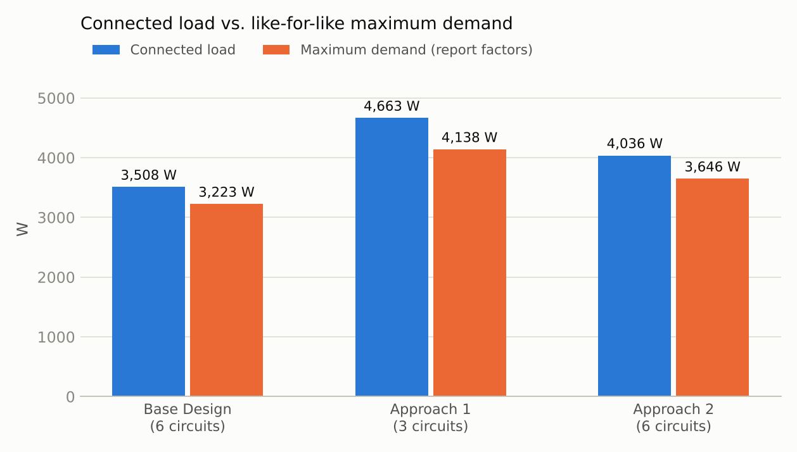</p>

| Design | Connected | Max. demand | Demand current |
|--------|----------:|------------:|---------------:|
| Base | 3,508 W | 3,223 W | 14.0 A |
| Approach 1 | 4,663 W | 4,138 W | 18.0 A |
| Approach 2 | 4,036 W | 3,646 W | 15.9 A |

Approach 1 serves the highest demand because it provides the most sockets. Its selection
therefore rests on capacity, wiring simplicity and code grouping, not on lower load.
CKT-2 is also its tightest branch: 15.22 A on a 16 A MCB (95 %), partly because the report
applies a single PF of 0.9 to the whole circuit (12.68 A) where per-load PFs give 11.52 A.
That is conservative, so it is a margin to keep in mind rather than a defect.

### F3 – Cable-run and voltage-drop envelope

With the conductor at 70 °C and R′ from IEC 60228, the longest one-way run that keeps the
single-phase voltage drop within 3 % / 5 % at the *design* current (resistive drop only):

<p align="center">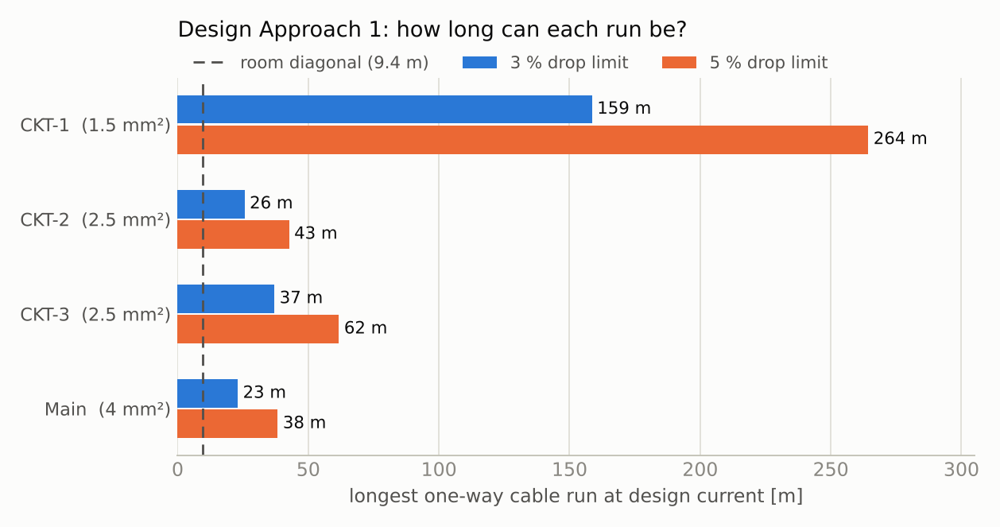</p>

| Circuit | Cable | I<sub>design</sub> | L<sub>max</sub> (3 %) | L<sub>max</sub> (5 %) |
|---------|-------|------:|------:|------:|
| CKT-1 | 1.5 mm² | 1.50 A | 159 m | 264 m |
| CKT-2 | 2.5 mm² | 15.22 A | 25.6 m | 42.6 m |
| CKT-3 | 2.5 mm² | 10.51 A | 37.0 m | 61.7 m |
| Main | 4 mm² | 27.23 A | **23.0 m** | 38.3 m |

Inside the room (diagonal 9.4 m) every branch has ample margin. The **meter-to-SDB
feeder** is the one to check: at 27 A it should not exceed about 23 m for a 3 % drop.
The report does not state that length.

### F4 – The "≥ 300 lux" lighting claim needs a luminaire datasheet

By the lumen method (E = N·Φ·UF·MF / A, A = 38.6 m², MF = 0.8), 300 lux with twelve tubes
needs roughly **2,000 lm per tube at UF 0.6, 2,400 lm at 0.5, 3,000 lm at 0.4**. A 24 W
LED luminaire commonly delivers about 2,000–3,000 lm, so the claim is plausible but
depends on the actual fixture and room surfaces. Lighting power density is
**7.5 W/m²** (Approach 1) vs 8.7 W/m² (Approach 2, 14 tubes). Approach 2's 14 tubes would
give about 17 % more total flux; the report's argument for Approach 1 is about uniformity,
which this check does not assess.

### F5 – Lobby lighting is missing from the Approach 1 and 2 schedules

The Base Design carries 45 W of entry/lobby lights (Ck-4). They are not in the Approach 1
or 2 load schedules (288 W and 336 W of tubes only), although the report lists them in
the surveyed equipment and the final slide deck's Approach 1 layout legend shows a fourth
"Entry / Misc" circuit. Impact is small: +0.23 A design current, CKT-1 would be 1.74 A on
a 6 A MCB, and no breaker or cable changes.

### F6 – Approach 2 socket arrangement is inconsistent across the submission

The report's schedule gives CKT-5 as **6 × 3-pin sockets (1,800 W)** on a 16 A MCB, total
4,036 W, and its comparison table lists 6 sockets. But its own *dual socket panel*
connection diagram (shown in §4.3) has **eight outlets** (R1–R3 and P1–P5) under a
"10 A MCB, 2.5 mm²" heading, and the final slide deck shows **3 × 3-pin (900 W) +
5 × 2-pin (1,000 W)** on two panels with a total of about 4,040 W (design current
≈ 22.3 A). The schedule, diagram and deck should be reconciled before the design is handed
over; the tables in this README follow the report's schedule.

## 7. Limitations

- **Standards are cited, not re-read.** BNBC 2020 clauses, the demand factors and the
  cable ampacities (15 / 22 / 30 A) are used exactly as printed in the report; they were
  not checked against the code text. Ampacity depends on installation method; the F1
  audit is internal to the report's own table.
- **No cable-length data** was available, so voltage drop is reported as a maximum run, not
  a result. Drop is resistive only.
- **No cost model:** "lower installation cost" is the report's qualitative judgement.
- The lighting check uses assumed utilisation and maintenance factors.
- The `.dwg` files are included unchanged. They were not re-opened or modified here;
  Design_1 / Design_2 correspond to Approach 1 / 2 (their embedded previews match the
  layouts in Figs. 5 and 10 of the report).
- A real installation needs a registered engineer's review and local utility approval.

## 8. Reproducing the results

```bash
pip install -r requirements.txt
python -m pytest -q                  # 34 passed
python analysis/run_analysis.py      # tables + docs/figures/chart_*.png + analysis/results.json
```

Open the `.dwg` files in AutoCAD 2018 or later (DWG format AC1032).

## 9. Repository layout

```
cad/                       AutoCAD drawings: Base_Design.dwg, Design_1.dwg (Approach 1), Design_2.dwg (Approach 2)
data/designs.json          circuit schedules, supply, demand factors, ampacity and resistance tables
calc/service_calc.py       calculation engine (currents, coordination, demand, voltage drop, lumen method)
tests/test_calc.py         34 tests: reproduce the report, then the audit findings
analysis/run_analysis.py   independent checks and charts
analysis/results.json      numerical output
docs/figures/              site photos, CAD layouts, connection diagrams, charts
```

## 10. Authors, references, licence

**Contributors**

| Member | Contribution (from the report) |
|--------|--------------------------------|
| Enamul | AutoCAD Base Design, comparative analysis |
| Intisar | room survey, presentation slides, report writing |
| Nabil | circuit diagrams |
| Ziya | AutoCAD Design Approaches 1 and 2 |
| Sajid | load calculations, SLD diagrams |

**References** (as listed in the report)

1. Housing and Building Research Institute, *Bangladesh National Building Code (BNBC) 2020*, Dhaka, 2020.
2. IEC 60228:2004, *Conductors of insulated cables*.
3. IEC 60364-4-41:2005, *Protection for safety – protection against electric shock*.
4. IEC 60364-5-52:2009, *Selection and erection of electrical equipment – wiring systems*.
5. M. A. Grainger and W. D. Stevenson Jr., *Power System Analysis*, McGraw-Hill.

**Licence.** [MIT](LICENSE). The audit code, tests and charts were added after the
coursework submission.
